# Biome Triad

A real-time, explorable 3D biome engine built on Three.js (r160, WebGL2). It ships with six complete,
procedurally built worlds: the Amazon rainforest, tropical Sea islands, Ancient Egypt on the Nile, a frost-bitten
Arctic archipelago, an erupting Volcanic valley and a divine Haven of floating islands above a sea of clouds.
New biomes plug in as packages for open worlds, games and apps. Every world runs on to the horizon and keeps the
viewer inside its playable area.

**Run it:** open `index.html` in any modern browser, or serve the folder with any static host
(GitHub Pages, Vercel, Netlify). There is no build step; three.js loads from jsDelivr through an import map.

| Amazon (aerial, dawn) | Amazon (river, lily pads and lianas) |
|---|---|
| 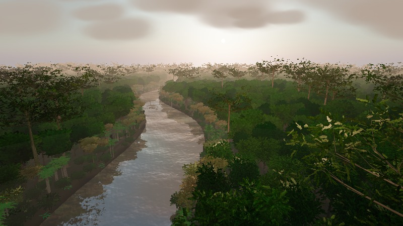 | 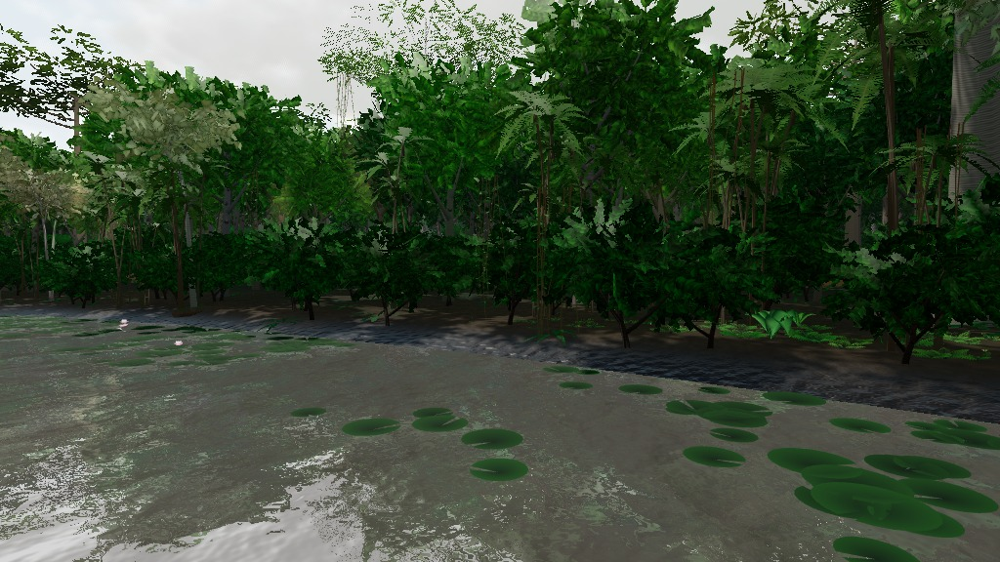 |
| **Amazon (understory)** | **Egypt (Nile, temple, pyramids)** |
| 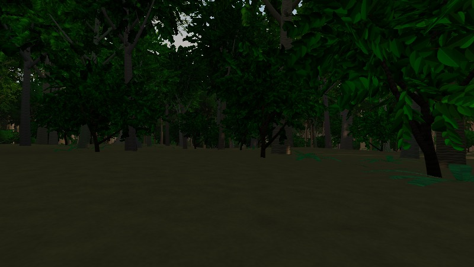 | 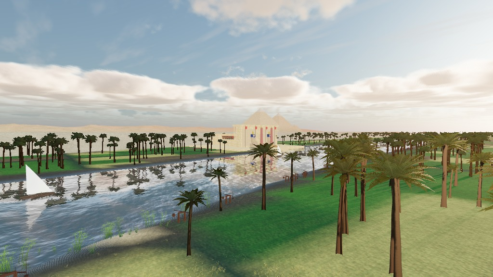 |
| **Egypt (crop fields, mud-brick village)** | **Egypt (stepped limestone pyramids)** |
| 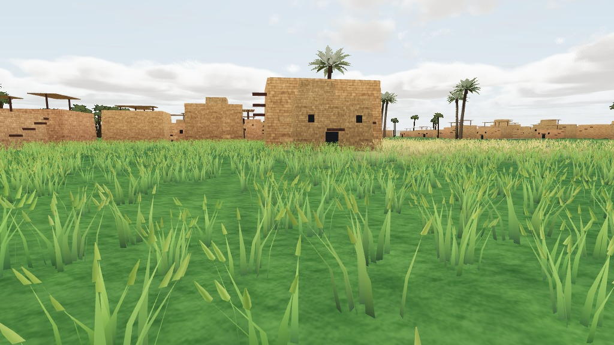 | 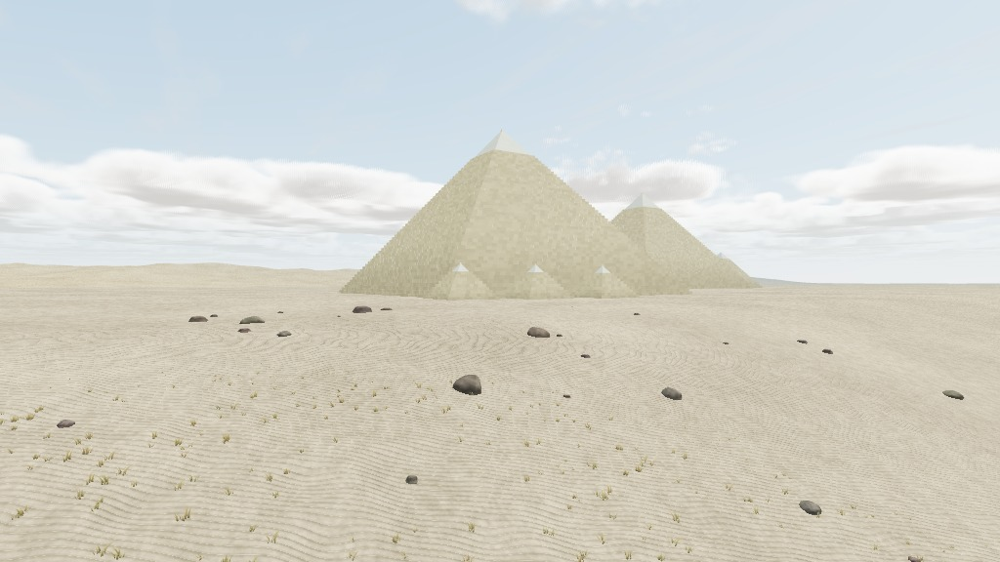 |
| **Sea (islands at dusk)** | **Sea (reef and shoreline foam)** |
| 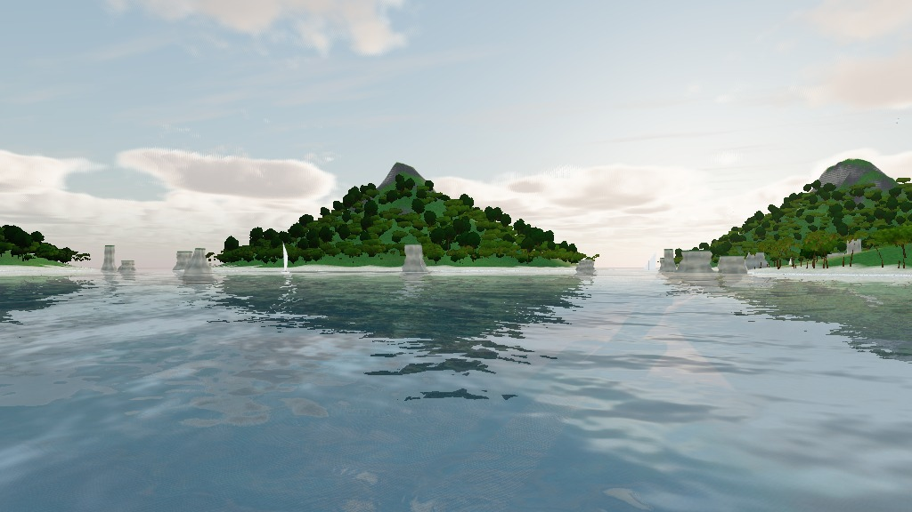 | 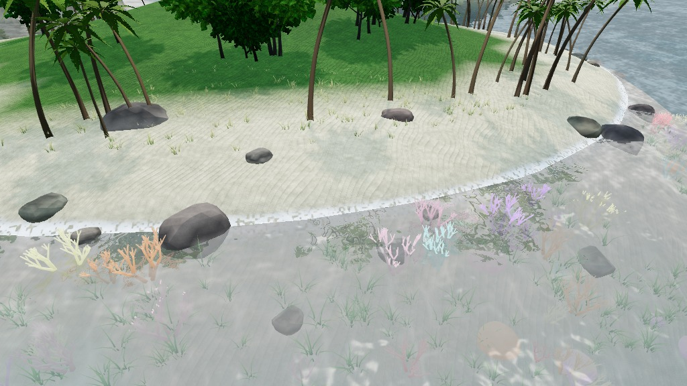 |
| **Sea (storm, rain with volumetric cloud deck)** | **Arctic (tidewater glacier and icebergs)** |
| 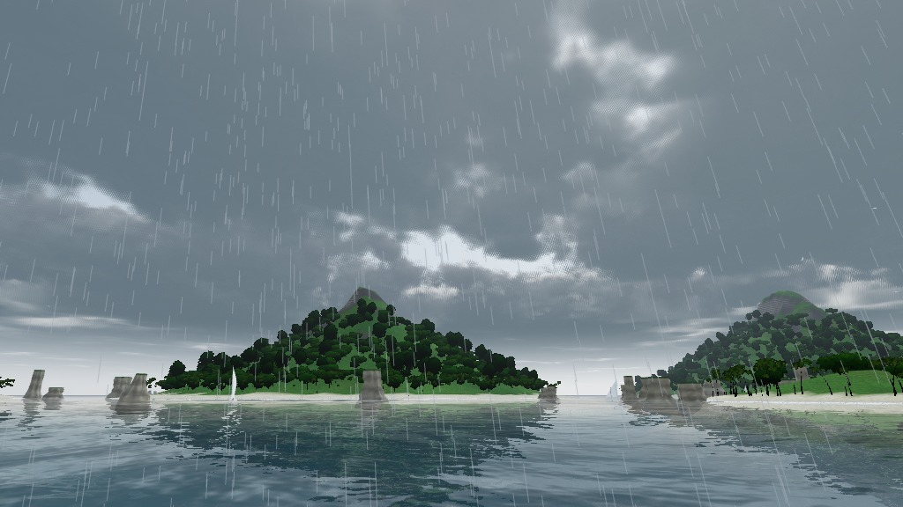 | 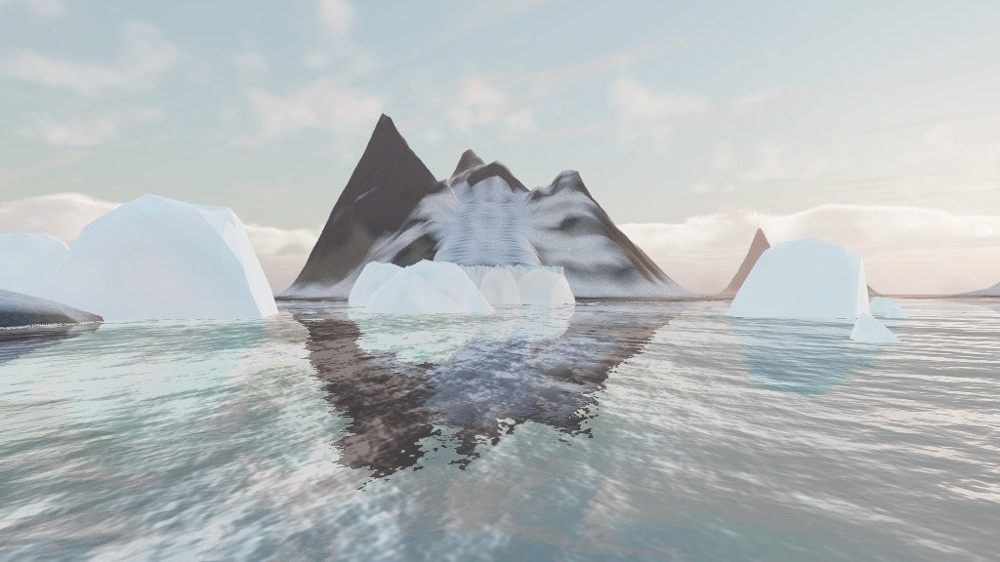 |
| **Arctic (aurora at night)** | **Arctic (cabin, inukshuks, whale skeleton)** |
| 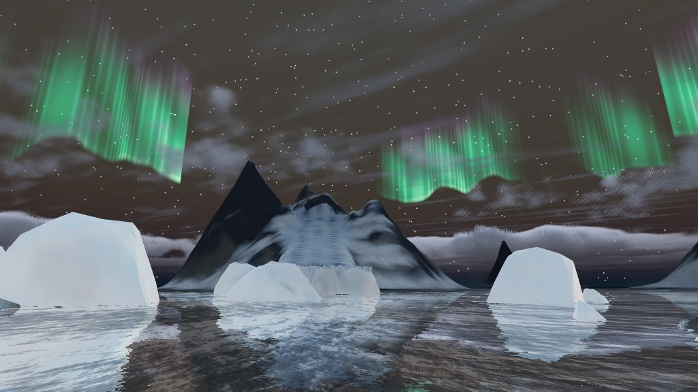 | 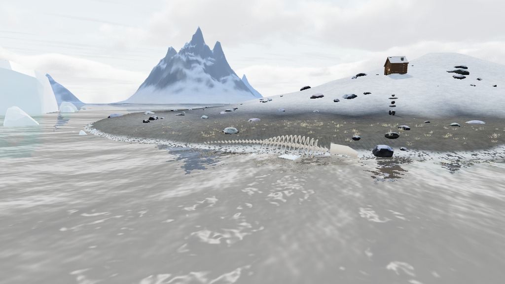 |
| **Volcanic (lava river and ash plume)** | **Volcanic (night)** |
| 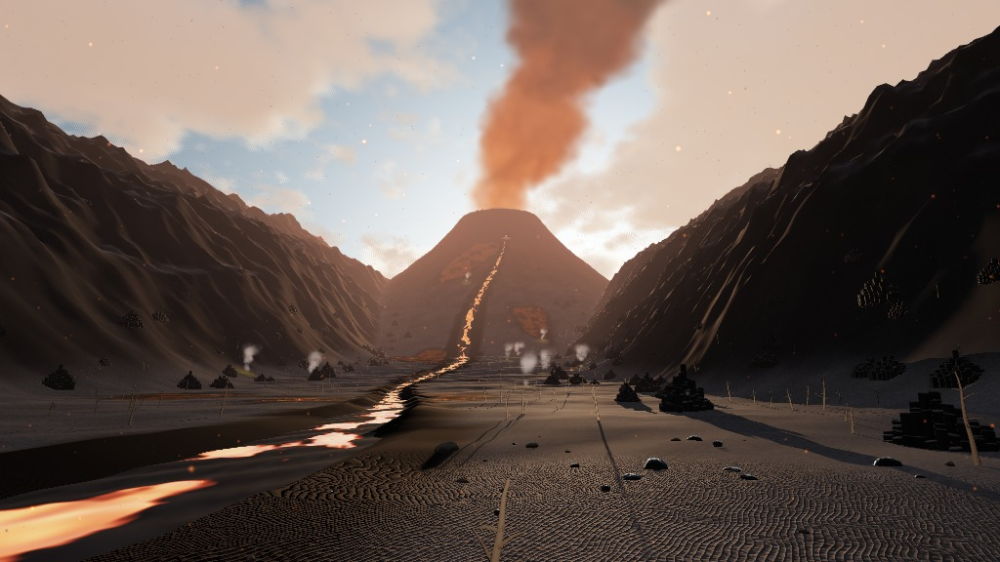 | 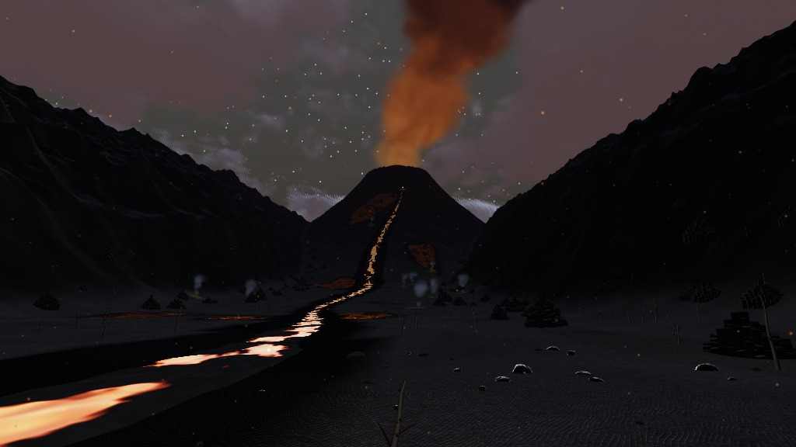 |
| **Volcanic (valley from above)** | **Haven (sky bridge to the sanctuary)** |
| 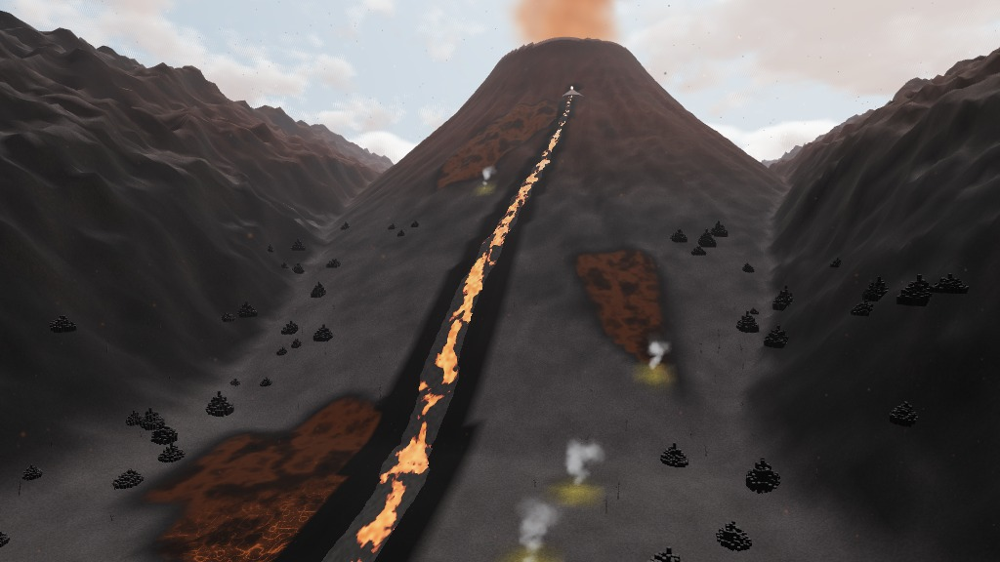 | 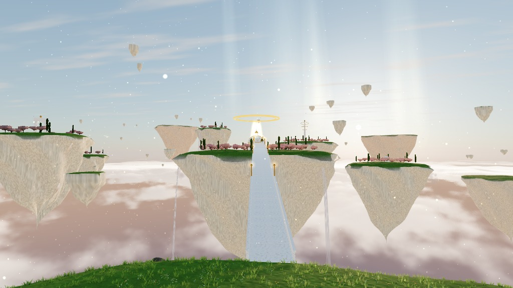 |
| **Haven (tholos, halo, blossom groves)** | **Haven (sea of clouds)** |
| 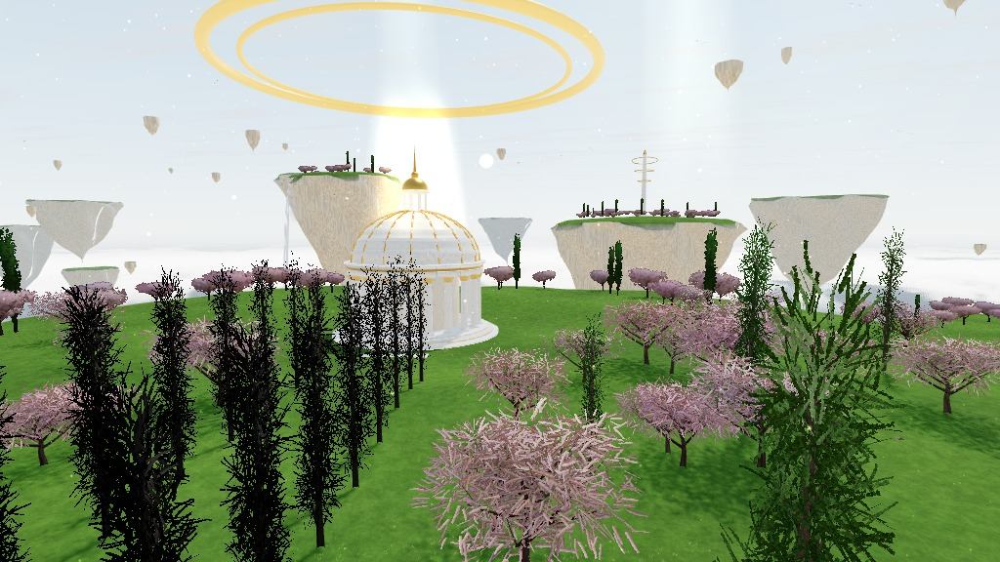 | 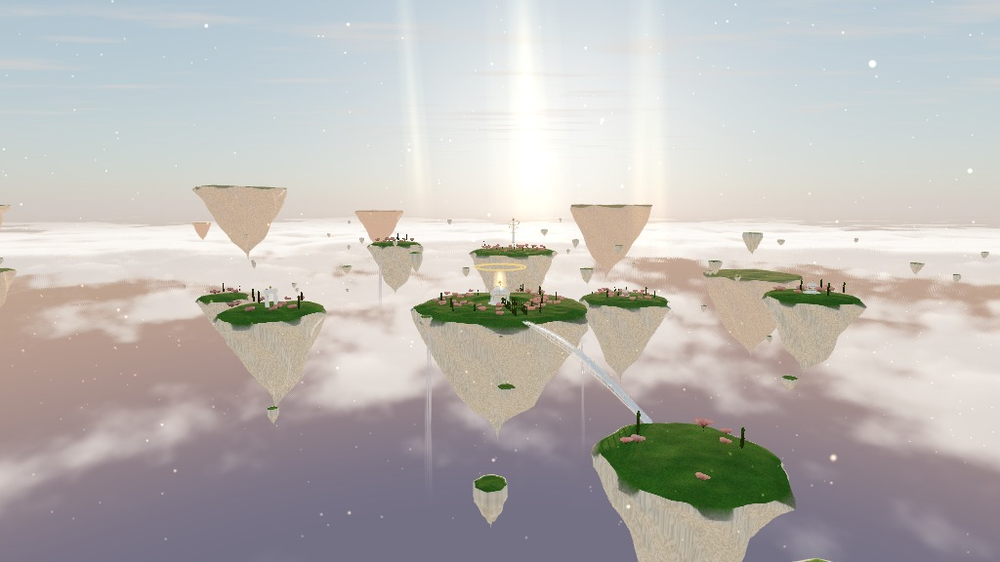 |

## Controls

| Input | Action |
|---|---|
| WASD / arrows | Move |
| E / Space, Q / C | Rise, sink |
| Shift | Move fast |
| Drag | Look |
| Double-click | Mouse lock |
| 1–6 | Switch biome |
| H | Hide controls |
| Touch joystick | Move on phones |

The HUD also switches time of day (dawn, noon, dusk, night), weather (clear, rain with lightning, fog)
and quality (Fast, Balanced, Ultra). Phones start on Fast. Deep links: `index.html#amazon`, `#sea`, `#egypt`, `#arctic`, `#volcano`, `#haven`.

## Engine overview

All code lives in `index.html`, grouped into these sections:

- **Renderer:** WebGL2 with MSAA, a logarithmic depth buffer (no z-fighting from 0.5 m to 16 km),
  ACES filmic tone mapping, PCF soft shadows on a texel-snapped shadow camera that follows the viewer,
  and a physical sky (`Sky.js`) that also feeds image-based lighting through PMREM.
- **Atmosphere:** sun and moon lighting, exponential fog tinted per biome, stars, rain streaks, lightning and
  shared wind uniforms. Clouds are volumetric: a raymarched cumulus slab (3D noise, sun-marched self shadowing,
  dual-lobe phase function, powder term) plus a cirrus deck, drawn on a sky dome. Each biome sets its own
  `clouds: { cover, base, top, cirrus, dark }`; rain thickens and darkens the deck, fog hides it, and the planar water
  reflection gets the same sky at half the march steps. The slab is marched from whichever side the viewer is on,
  so a biome can put it below the camera (the Haven's sea of clouds).
- **Precipitation:** rain streaks with lightning, plus world-anchored snow, ash or glowing motes chosen per biome
  with `precip`.
- **World edges:** `makeTerrain({ apron })` adds a coarse ring sampled from the same height and colour functions
  (optionally lifted, e.g. into a distant canopy) out to the horizon; `bounds`, `floor` and `ceiling` keep the
  viewer inside the playable area.
- **Terrain shading (`terrainMaterial`):** world-space noise breaks up vertex colour at three scales, slopes blend to
  banded strata rock, shorelines go wet and glossy, and per-biome options add wind-rippled sand, crop rows,
  animated shoreline foam, underwater caustics, snow glints, glowing lava-crust cracks and glacier ice
  (selected by a per-vertex `kind`). The bump is an analytic finite-difference normal
  perturbation with each octave faded by distance (no screen-derivative blockiness).
- **Ground cover (`scatter`):** instanced tiles are generated around the viewer from a deterministic `place()`
  callback and dropped behind it, so density is not limited by what the world can hold up front. Plants are real
  geometry (`bladeClump` with seed heads, `papyrusClump`, `fernPlant` with leaflet pairs, `broadleafPlant`,
  `lianaGeo`, `lilyGeo`, coral, boulders, logs) with wind sway, backlit translucency and a distance shrink fade.
- **Water:** planar-mirror `Water.js` on Balanced and Ultra; a cheap normal-mapped PBR surface on Fast.
- **Verdant (vegetation):**
  - `genTree(spec, seed)`: procedural broadleaf trees with buttressed trunks, branches, sub-branches and
    leaf-spray cards that radiate from the twigs, using spherical crown normals and baked occlusion.
  - `genPalm(spec, seed)`: palms with curved trunks, a leaf-base boot and V-folded, drooping pinnate fronds.
  - `sprayAtlas()` / `frondTexture()`: leaf textures painted leaf by leaf (midribs, veins, fold shading),
    uploaded as DataTextures so mipmaps have no dark fringes.
  - Foliage material: Standard PBR plus a translucency term (leaves glow toward the sun), wind sway,
    leaf flutter and a per-instance distance fade.
  - Impostors: every species is baked once into an 8-view albedo and normal atlas. Distant trees are
    single camera-facing quads lit with the same sun and sky as near trees, and they cross-fade into the
    full mesh with a screen-space dither. Near meshes are binned into 70 m tiles and culled by distance,
    which keeps around 17,000 Amazon trees interactive.
- **Biomes:** registered with `Helios.registerBiome({...})`.
  - **Amazon:** procedural broadleaf canopy with kapok emergents; understory of leaflet-built ferns, folded heliconia,
    bromeliads, fallen logs and mossy boulders; river with lily pads and lotus flowers; hanging liana curtains built
    from sagging strands with leaf blades; sun shafts that follow the viewer under the canopy; macaw pairs.
  - **Egypt:** pyramids built block by block (risers, treads, per-block depth jitter, patchy erosion, polished casing
    and gilded cap); a temple with a carved-glyph pylon, colossi, obelisks, a ram-sphinx avenue, flagpoles and a
    hypostyle hall of fluted columns with painted papyrus-bud capitals; mud-brick houses with roof stairs, beams
    and awnings; crop fields (barley, wheat) with seed heads; papyrus and reeds on the Nile bank; shadufs; rippled
    dunes with scrub and boulders.
  - **Sea:** islands with hummocks, cliffs and beaches; foam and caustics from the terrain shader; a reef of
    branching and brain coral with seagrass; fluted sea stacks; beach grass, jungle-floor ferns and heliconia;
    gull flocks and fish schools animated by instance-driven wing and tail beats.
  - **Arctic:** a barren archipelago of multi-summit islands with snow on the flats and dark rock on the steeps; a
    tidewater glacier with moraine stripes ending in a fluted, serac-topped ice cliff; calved icebergs (noise-swollen,
    plane-cut, lit by a cold subsurface term) and thousands of pack-ice floes; snow-capped boulders, frosted tussocks
    and ice blocks on the strand; a log cabin with a lit window, inukshuks and a bleached whale skeleton; sea smoke,
    petrels, drifting snow (a blizzard in rain) and folded aurora curtains at night.
  - **Volcanic:** a rugged valley climbing to a gullied stratovolcano; a lava river from a spatter-cone vent down the
    valley between levees, plus a crater lava lake, both with drifting crust plates over HDR molten glow and a lava
    light that follows the viewer; cooled flows with glowing cracks; an ash plume with ember-lit base and eruption
    pulses with volcanic lightning; lava bombs and spatter; fumaroles over sulfur crusts; columnar basalt
    colonnades, obsidian boulders and charred snags; falling ash and rising embers.
  - **Haven:** floating islands with meadows on top and hanging marble-strata undersides over a sea of clouds and a
    deep-blue abyss; a marble tholos with fluted columns, gilded capitals, a ribbed dome and lantern; a reflecting
    pool, cypress avenue and a walkable arched sky bridge with balustrades and lamps; a triumphal gate, a spire with
    turning gold rings and two small shrines; a gilded double halo with a pillar of light and beams from the sky;
    waterfalls pouring off the rims; blossom and cypress groves, wildflowers, drifting rock debris and far islands;
    doves and golden motes.

## Adding a biome

```js
Helios.registerBiome({
  id: 'taiga', label: 'Taiga',
  sky: { turbidity: 4, rayleigh: 1.5, mie: 0.005, mieG: 0.8 },
  fog: { density: 0.0012, tint: [0.9, 0.95, 1.0] },
  ground: [0.2, 0.22, 0.18],                       // hemisphere bounce colour
  camera: { pos: [0, 12, 0], look: [0, 8, -200] },  // or a function returning that
  clouds: { cover: 0.4, base: 1500, top: 3000, cirrus: 0.3 },   // volumetric sky for this biome
  precip: { kind: 'snow', base: 0.1, storm: 0.9, rainLines: false },  // optional snow / ash / motes
  bounds: [0, 0, 950],                                         // viewer stays within 950 m of the centre
  build(k) {
    const heightAt = (x, z) => 20 * k.noise.fbm(x * 0.003, z * 0.003, 5);
    const group = new k.THREE.Group();
    group.add(k.makeTerrain({ size: 2000, seg: 400, height: heightAt, apron: { size: 9000 },
      detail: { rock: [0.4, 0.37, 0.33], rockLo: 0.3, bump: 14, wet: 0.5 },   // optional: ripple, rows, foam, caustic
      color: (c, x, y, z, ny) => k.srgb(c, 0.3, 0.32, 0.25) }));
    group.add(k.makeWater({ size: 2000, color: 0x123040 }));

    // Define your own species (or reuse canopyA, canopyB, kapok, cecropia,
    // shrub, island, datePalm, coconut, acai)
    k.defineSpecies('spruce', { seed: 1, bark: 0x6b5a4a,
      leaves: () => k.sprayAtlas(2, { hue: 0.33, sat: 0.4, light: 0.2, len: [30, 50], width: 0.12, count: [30, 40], twig: '#3a2e20' }),
      tree: { h: 30, r: 0.5, buttress: 0, lean: 0.03, wobble: 0.3, trunkTop: 1.0, bStart: 0.2, branches: 18,
              el: [-0.2, 0.2], bLen: 0.12, curl: 0.05, subs: 1, cR: 1.6, flatY: 0.6, cards: 18, card: 1.4, droop: 0.4 } });

    const F = k.forest();
    for (let i = 0; i < 5000; i++) {
      const x = (Math.random() - 0.5) * 1800, z = (Math.random() - 0.5) * 1800;
      F.add('spruce', x, heightAt(x, z), z, 0.8 + Math.random() * 0.4, Math.random() * 6.28);
    }
    group.add(F.build());

    // Streaming ground cover: place() returns { y, s, c? } or null for each candidate position
    const tuft = k.bladeClump({ blades: 8, seg: 3, h: [0.3, 0.7], w: 0.035, spread: 0.2, bend: 0.6,
      colA: k.lin(0.1, 0.2, 0.06), colB: k.lin(0.4, 0.55, 0.2), seed: 1 });
    const grass = k.scatter({ geo: tuft, mat: k.plantMat({ wind: 0.05 }), radius: 70, per: 0.8,
      place: (x, z, r) => ({ y: heightAt(x, z), s: 0.7 + r() * 0.8 }) });
    group.add(grass.group);
    return { group, heightAt, update(dt, env) {} };   // scatter tiles follow the viewer automatically
  }
});
```

The biome appears in the HUD automatically and inherits time of day, weather, quality levels, LOD,
impostors, volumetric clouds and the walk floor.

## Visual verification

`tools/render-harness` renders views headlessly, using SwiftShader (software WebGL), so changes can be
checked without a GPU:

```bash
cd tools/render-harness
npm install
node shot.mjs ../../index.html out/check \
  '[{"biome":"amazon","q":"balanced"},{"cam":[60,75,250,0,-0.25]},{"biome":"egypt"},{"biome":"sea"}]' 960 540
```

Each job saves a JPEG and prints the triangle count and draw calls. A job accepts `biome`, `q`, `tod`,
`wx` (`clear`, `rain`, `fog`), `cam` (`[x, y, z, yaw, pitch]`) and `steps`. The engine exposes
`window.__helios` (`load`, `setQuality`, `snap`, `stats`) only for this harness.

## Repository layout

```
index.html                     The engine and the six biomes (single file, no build)
docs/renders/                  Reference frames from the render harness
tools/render-harness/          Headless screenshot tool (puppeteer + SwiftShader)
legacy/                        The original GLSL ES 3.00 raymarched version this project grew from
```

## Known gaps

- Performance was not profiled on physical GPUs or phones. The harness renders in software and reports triangle
  counts only. At Balanced the Amazon runs about 1.3 to 2.4 million triangles and Egypt about 0.5 to 1.7 million,
  depending on the view. Ground cover density and radius scale with the Fast, Balanced and Ultra levels.
- The volumetric clouds are the most expensive screen-space pass (14, 28 and 40 march steps per quality level).
  Far cloud detail is dropped past a fixed distance, and cloud edges can show faint dither banding.
- The Great Sphinx, interior chambers and hieroglyph colour are not modelled; the pylon glyphs are procedural
  marks, not real text.
- Fish, gulls, petrels and doves follow scripted orbits rather than flocking behaviour.
- The Volcanic and Haven worlds add point lights, extra transparent passes (plume, waterfalls, light beams) and a
  second reflection on the Haven pool at Balanced and Ultra; like the rest, they were only measured in software
  (about 0.6 to 1.5 million triangles at Balanced).
- Cooled lava flows, sulfur crusts and the glacier are painted per terrain vertex, so their outlines follow the
  terrain grid (5 to 10 m) when seen from above.
