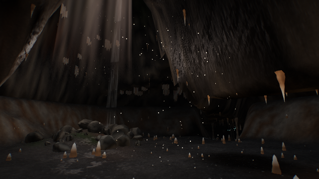
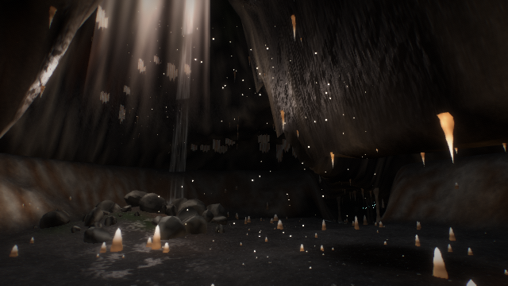
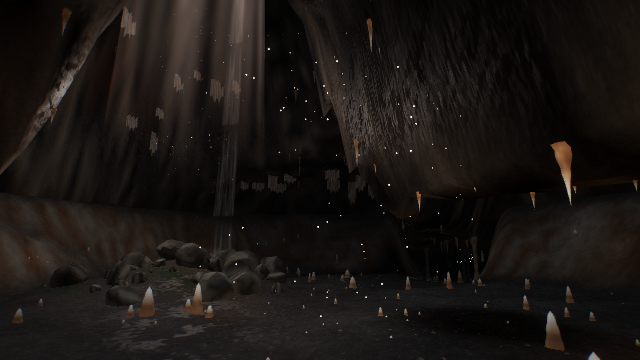
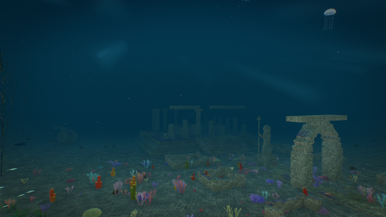
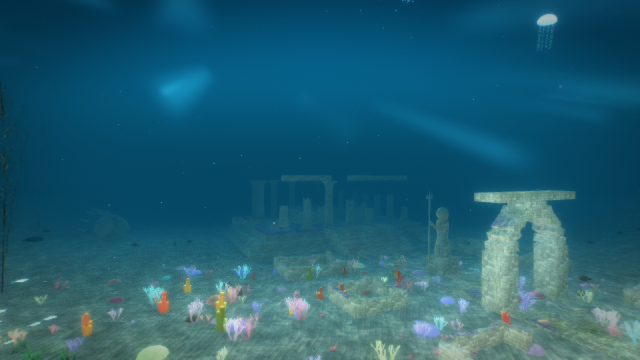
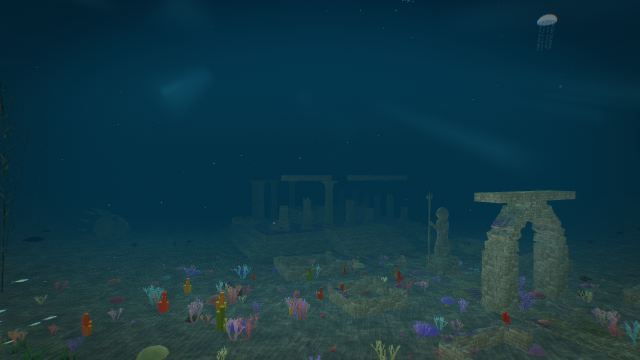
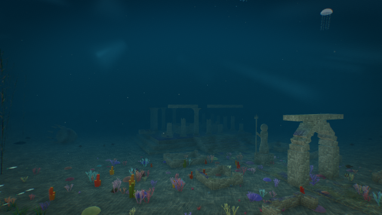

# Postprocessing override verification

Base: `61fb9cb9e4b782470549a486f1cbfc8c8f318853` (merged PR #5).

The harness now resolves settings as explicit override → live world → biome
configuration → engine default. No world definitions or update functions changed.

## Checks

**Result: 17/17 environments passed; no browser page errors.** The additional
focused run passed for both Caverns and Underwater.

- 22 deterministic Node tests passed (5 harness regressions and 17 existing surface-state tests).
- Browser verification uses real Chromium 123 WebGL rendering through SwiftShader,
  640×360, balanced quality. See `results.json` for each environment's settings.
- Every registered biome is loaded and rendered. Its initial applied settings are
  compared with the original live/definition/default precedence expression.
- All supported controls are explicitly overridden, then the world is simulated
  and rendered again to check that live updates cannot replace the overrides.
- Bloom and AO are individually toggled between 0 and 1 on the exact same scene,
  camera and simulation time; each pair must produce different PNG pixels.
- Clearing overrides must restore byte-identical PNG output at fixed scene/time.
  Reloading must clear overrides and restore the world's own settings.
- Screenshot jobs without biome reload are covered by executing the actual job
  callback in a deterministic test; settings cannot leak into the next job.

These checks verify settings and rendering behavior, not a broad artistic or
performance assessment. Quality-level effect gates remain unchanged.

## Caverns and Underwater: actual rendered comparisons

Only the named effect changes within each row. Enabled strength is 1; disabled
strength is 0. For bloom comparisons, both images use `thresh: 0.25` to make the effect legible
at the deep-water camera; all other controls retain the world's live/default
settings. AO comparisons use the default threshold. The original full sweep also
checks bloom at each world's default threshold; `focused-results.json` records
the additional Caverns/Underwater run that generated these illustrative images.

| Scene / effect | Disabled | Enabled |
| --- | --- | --- |
| Caverns bloom |  |  |
| Caverns AO |  |  |
| Underwater bloom |  |  |
| Underwater AO |  |  |

## Reproduce

```sh
node --test tools/render-harness/tests/*.test.mjs extensions/surface-state/tests/*.test.mjs
cd tools/render-harness
npm ci
npm run verify:post
```

The new GitHub Actions workflow could not start in this account: GitHub reported
“The job was not started because your account is locked due to a billing issue.”
Local test and browser evidence are provided independently of that blocked CI run.

## Measured image differences

RGB values use the 0–255 scale. Bloom increases mean intensity; AO decreases it.

| Comparison | Changed pixels | Mean absolute RGB difference | Mean RGB change (on − off) |
| --- | ---: | ---: | ---: |
| caverns-ao | 20.283% | 0.2918 | -0.2918 |
| caverns-bloom | 74.149% | 4.8652 | 4.8652 |
| underwater-ao | 44.236% | 1.1104 | -1.1104 |
| underwater-bloom | 100.0% | 34.2844 | 34.2844 |
